# Kashkey Architecture Documentation

> **Technical Deep-Dive into the Kashmiri Keyboard Framework**

This document provides a comprehensive architecture overview of the Kashkey project, including data flow, component structure, and system design with Mermaid diagrams.

---

## Table of Contents

1. [High-Level Architecture](#1-high-level-architecture)
2. [Component Architecture](#2-component-architecture)
3. [Data Flow](#3-data-flow)
4. [Character Mapping System](#4-character-mapping-system)
5. [Keyboard Generation Pipeline](#5-keyboard-generation-pipeline)
6. [State Management](#6-state-management)
7. [Event Handling System](#7-event-handling-system)
8. [Audio System](#8-audio-system)
9. [Practice Mode System](#9-practice-mode-system)
10. [UI Component Hierarchy](#10-ui-component-hierarchy)
11. [File Structure](#11-file-structure)
12. [Complete Character Map](#12-complete-character-map)

---

## 1. High-Level Architecture

The Kashkey application follows a simple but effective single-page architecture with no external dependencies beyond fonts.

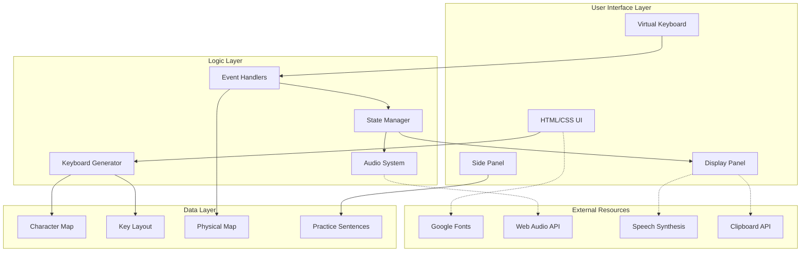

---

## 2. Component Architecture

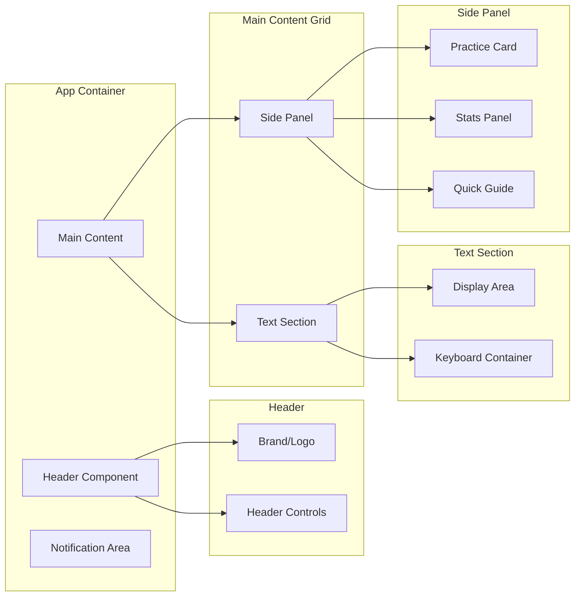

---

## 3. Data Flow

### 3.1 Input Processing Flow

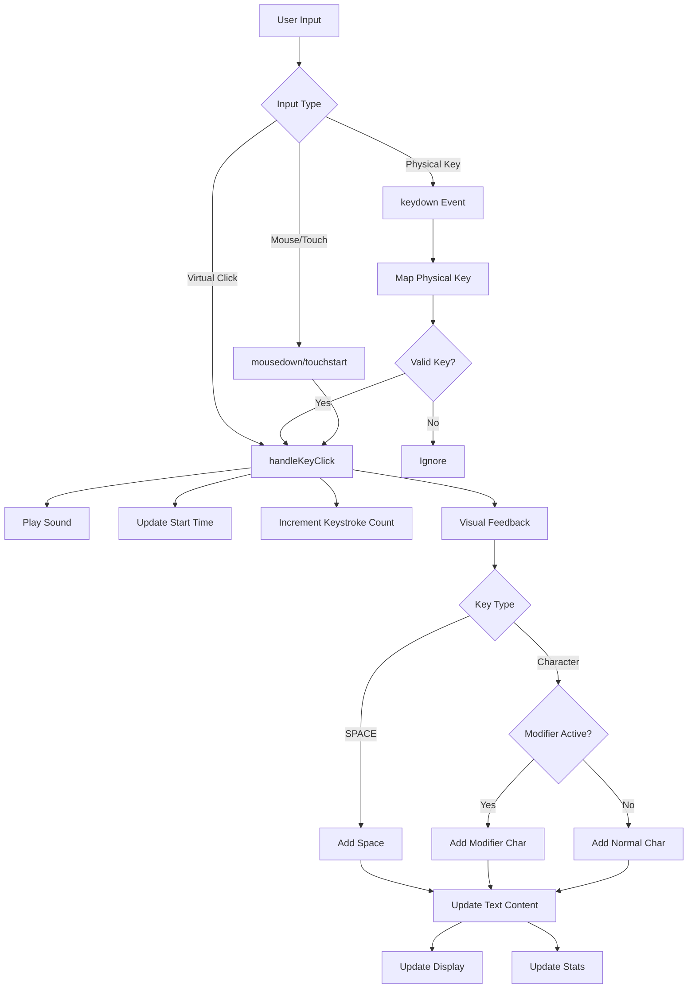

### 3.2 State Update Flow

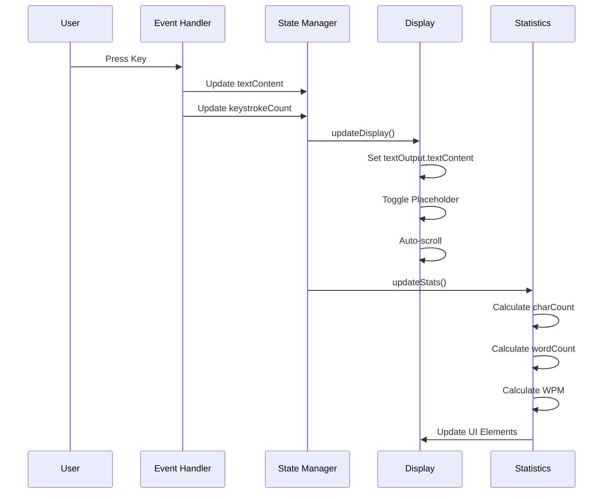

---

## 4. Character Mapping System

### 4.1 Mapping Structure

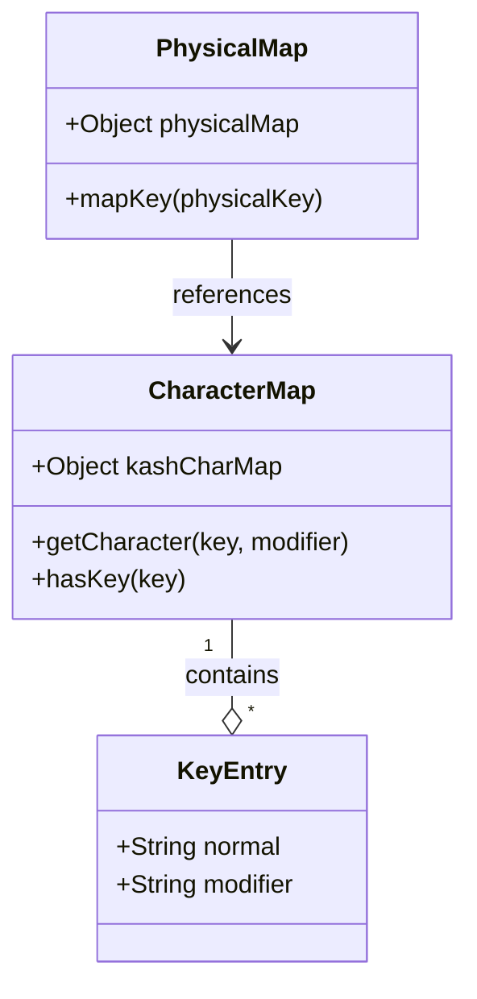

### 4.2 Key Mapping Example

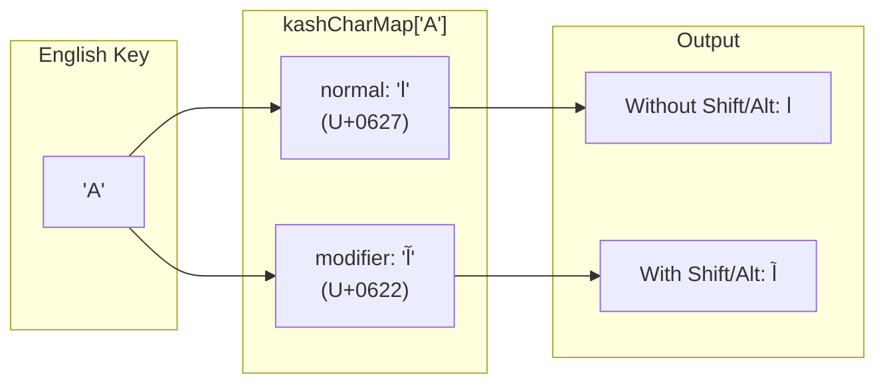

---

## 5. Keyboard Generation Pipeline

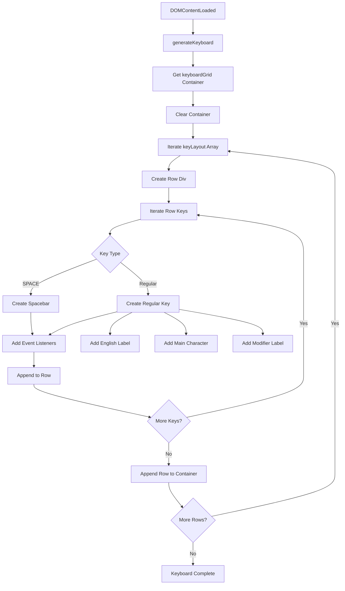

### 5.1 Key Layout Structure

```mermaid
graph TD
    subgraph "Row 0: Numbers"
        R0["`1234567890"]
    end
    
    subgraph "Row 1: Top Row"
        R1["QWERTYUIOP[]"]
    end
    
    subgraph "Row 2: Home Row"
        R2["ASDFGHJKL"]
    end
    
    subgraph "Row 3: Bottom Row"
        R3["ZXCVBNM,./"]
    end
    
    subgraph "Row 4: Space Row"
        R4["-SPACE"]
    end
    
    R0 --> R1 --> R2 --> R3 --> R4
```

---

## 6. State Management

### 6.1 Application State

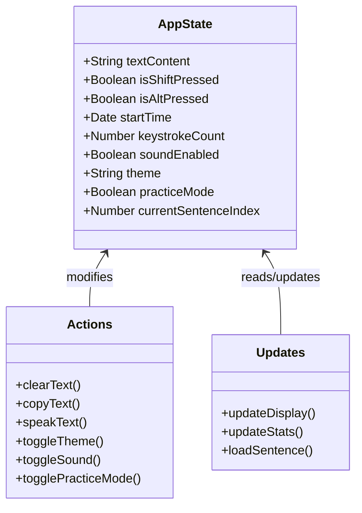

### 6.2 State Transitions

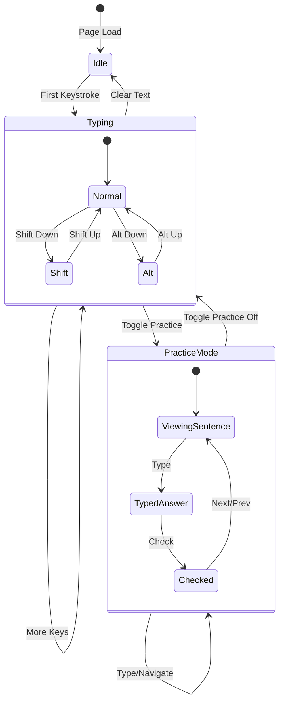

---

## 7. Event Handling System

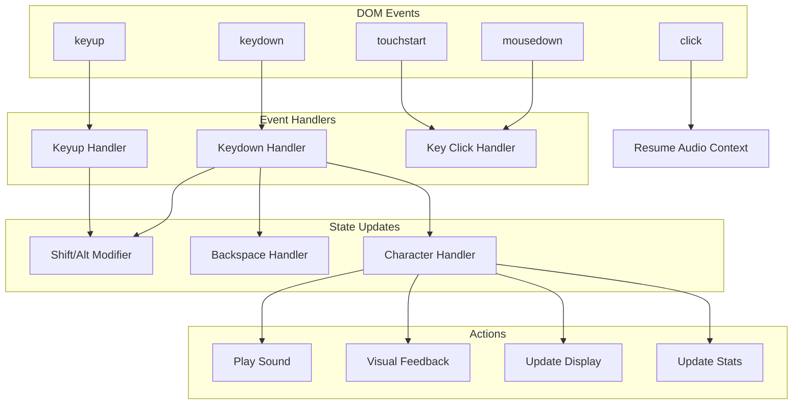

---

## 8. Audio System

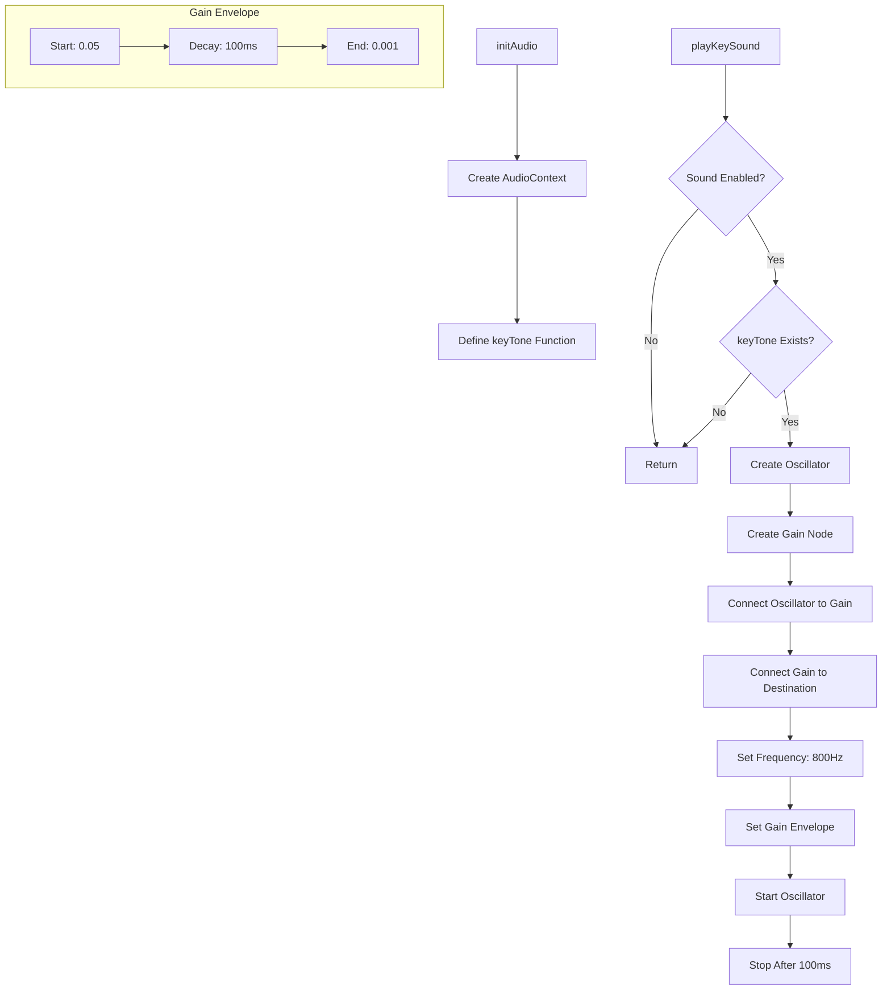

---

## 9. Practice Mode System

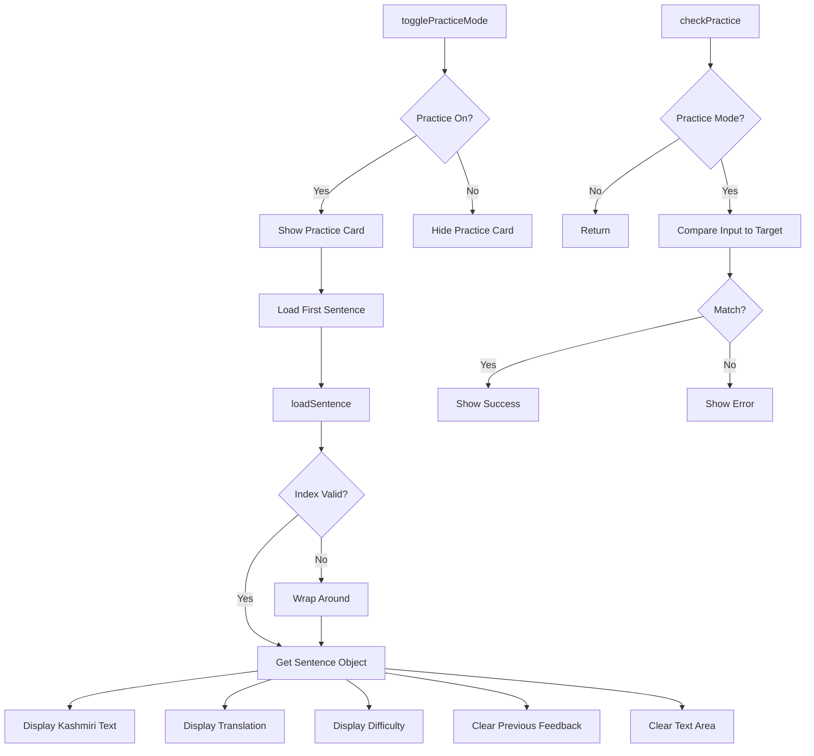

### 9.1 Practice Sentence Data Structure

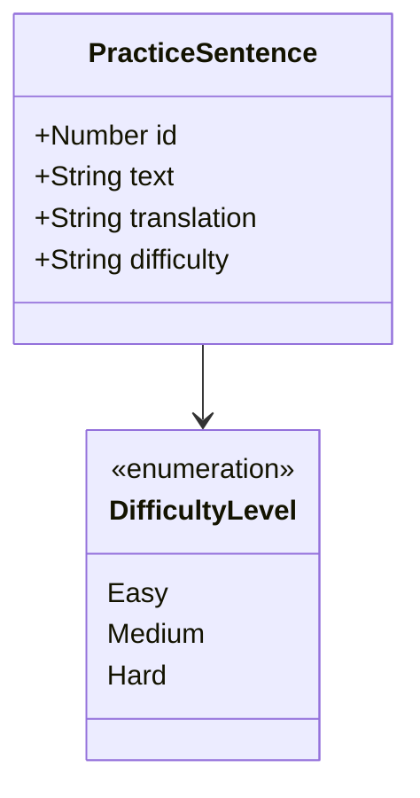

---

## 10. UI Component Hierarchy

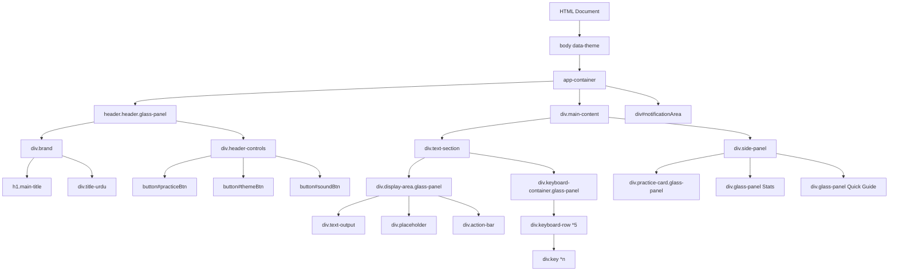

---

## 11. File Structure

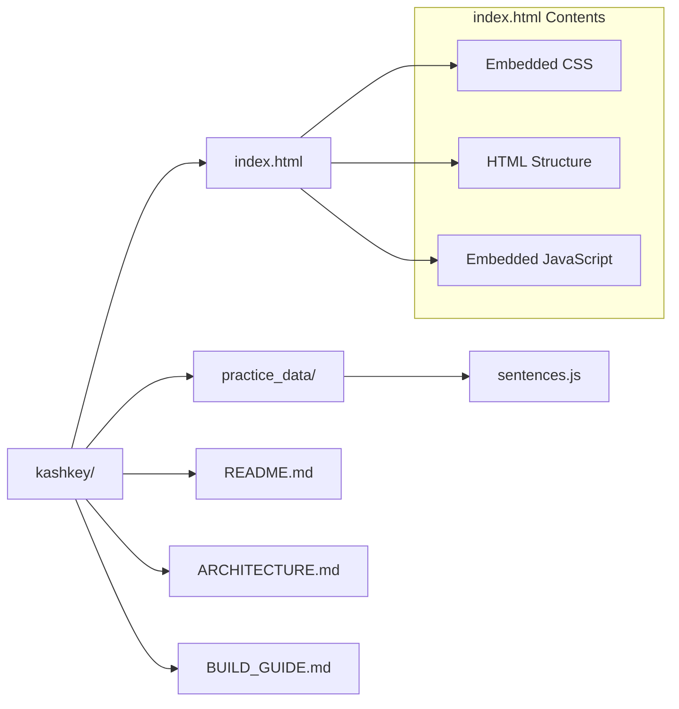

---

## 12. Complete Character Map

### 12.1 Number Row

| Key | Normal | Unicode | Modifier | Unicode |
|-----|--------|---------|----------|---------|
| ` | ` | U+0060 | ﷺ | U+FDFA |
| 1 | ۱ | U+06F1 | ؐ | U+0610 |
| 2 | ۲ | U+06F2 | ؓ | U+0613 |
| 3 | ۳ | U+06F3 | ؔ | U+0614 |
| 4 | ۴ | U+06F4 | ؃ | U+0603 |
| 5 | ۵ | U+06F5 | ؒ | U+0612 |
| 6 | ۶ | U+06F6 | ؑ | U+0611 |
| 7 | ۷ | U+06F7 | ْ | U+0652 |
| 8 | ۸ | U+06F8 | ' | U+2018 |
| 9 | ۹ | U+06F9 | ( | U+0028 |
| 0 | ٠ | U+0660 | ) | U+0029 |

### 12.2 QWERTY Row

| Key | Normal | Unicode | Modifier | Unicode |
|-----|--------|---------|----------|---------|
| Q | ق | U+0642 | ٍ | U+064D |
| W | ؤ | U+066E+U+06EA | ء | U+0621 |
| E | ع | U+0639 | ٰ | U+0670 |
| R | ر | U+0631 | ڑ | U+0691 |
| T | ت | U+062A | ٹ | U+0679 |
| Y | ے | U+06D2 | ّ | U+0651 |
| U | ٖ | U+0656 | ٗ | U+0657 |
| I | ی | U+06CC | ۍ | U+06CD |
| O | ہ | U+06C1 | ھ | U+06BE |
| P | پ | U+067E | ُ | U+064F |
| [ | ط | U+0637 | ' | U+2019 |
| ] | ظ | U+0638 | ' | U+2018 |

### 12.3 Home Row

| Key | Normal | Unicode | Modifier | Unicode |
|-----|--------|---------|----------|---------|
| A | ا | U+0627 | آ | U+0622 |
| S | س | U+0633 | ص | U+0635 |
| D | د | U+062F | ڈ | U+0688 |
| F | ف | U+0641 | ٚ | U+065A |
| G | گ | U+06AF | غ | U+063A |
| H | ح | U+062D | ٛ | U+065B |
| J | ج | U+062C | ض | U+0636 |
| K | ک | U+06A9 | خ | U+062E |
| L | ل | U+0644 | رحمتہ اللہ علیہ | Phrase |

### 12.4 Bottom Row

| Key | Normal | Unicode | Modifier | Unicode |
|-----|--------|---------|----------|---------|
| Z | ز | U+0632 | ذ | U+0630 |
| X | ش | U+0634 | ژ | U+0698 |
| C | چ | U+0686 | ث | U+062B |
| V | و | U+0648 | ۄ | U+06C4 |
| B | ب | U+0628 | ً | U+064B |
| N | ن | U+0646 | ں | U+06BA |
| M | م | U+0645 | ٕ | U+0655 |
| , | ، | U+060C | ِ | U+0650 |
| . | ۔ | U+06D4 | َ | U+064E |
| / | ٔ | U+0654 | ؟ | U+061F |
| - | ٲ | U+0672 | ۭ | U+06ED |

---

## Technology Stack Summary

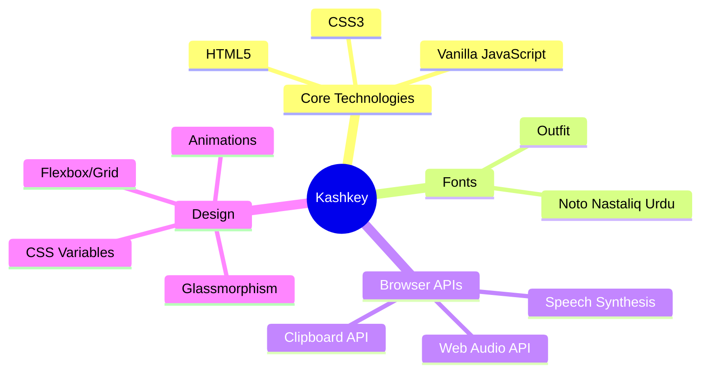

---

## Conclusion

The Kashkey architecture demonstrates that a sophisticated, feature-rich virtual keyboard can be built with:

- **Zero JavaScript dependencies** - Pure vanilla JS
- **Single HTML file** - Easy deployment
- **Modern CSS** - Glassmorphism with CSS variables
- **Modular data** - Separated character mapping and practice data
- **Browser APIs** - Leveraging native capabilities

This architecture is highly portable and can be adapted for any language by modifying the character mapping and keyboard layout arrays. See the [BUILD_GUIDE.md](./BUILD_GUIDE.md) for step-by-step instructions.
