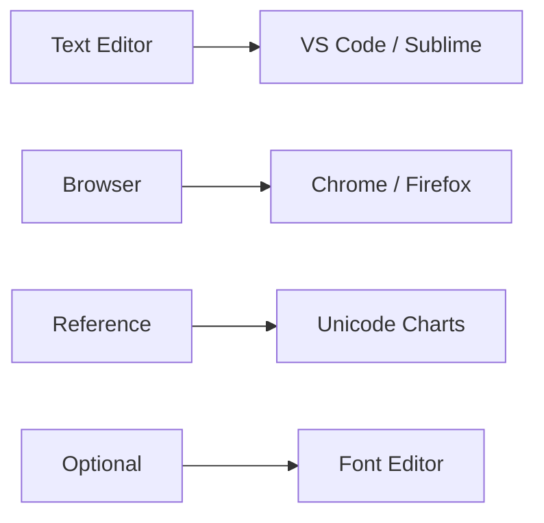
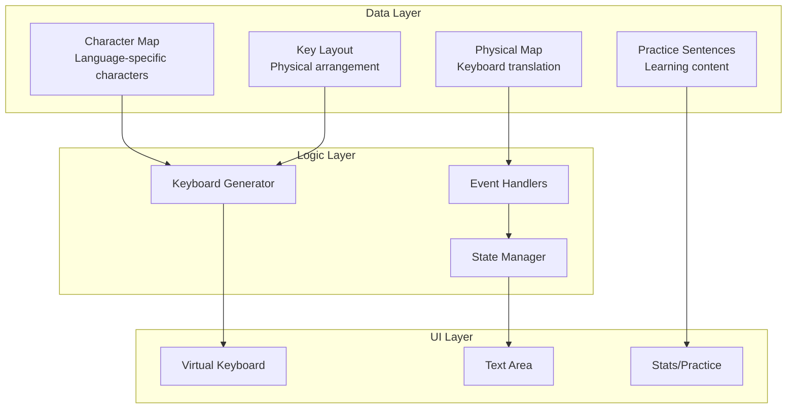
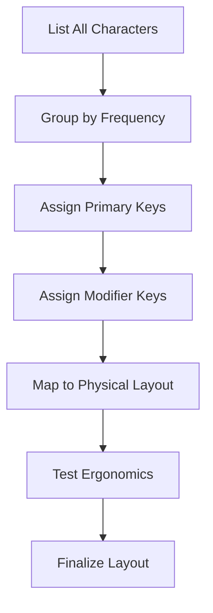
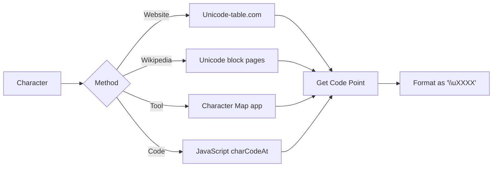
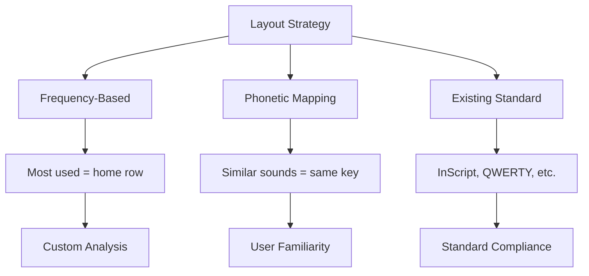
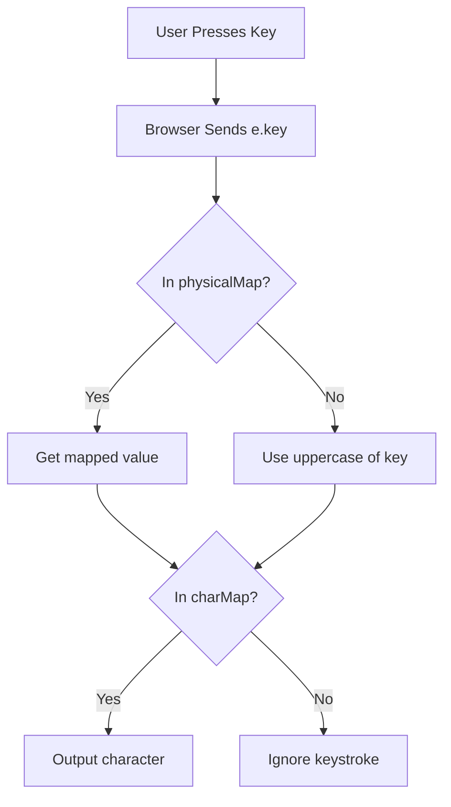
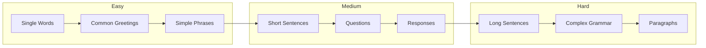
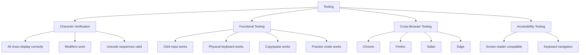
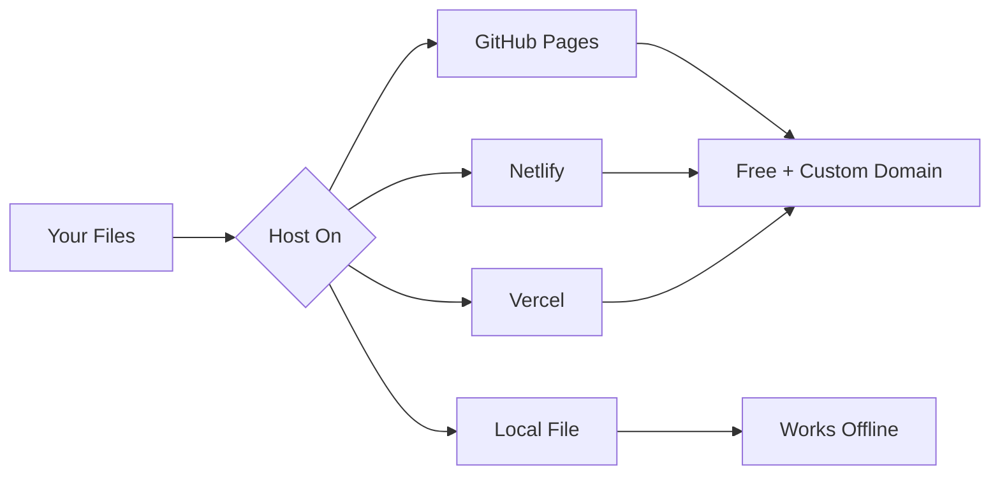
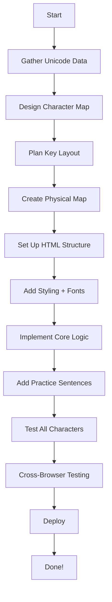

# Building a Virtual Keyboard Framework for Any Language

> **A Comprehensive Guide to Replicating the Kashkey Framework**

This guide provides step-by-step instructions for developers who want to create a virtual keyboard for any language using the Kashkey architecture as a template. Whether you're building for Arabic, Hindi, Thai, or any other language, this guide covers everything you need.

---

## Table of Contents

1. [Prerequisites](#1-prerequisites)
2. [Understanding the Framework](#2-understanding-the-framework)
3. [Planning Your Keyboard](#3-planning-your-keyboard)
4. [Step-by-Step Implementation](#4-step-by-step-implementation)
5. [Character Mapping Guide](#5-character-mapping-guide)
6. [Keyboard Layout Design](#6-keyboard-layout-design)
7. [Physical Keyboard Mapping](#7-physical-keyboard-mapping)
8. [Adding Practice Mode](#8-adding-practice-mode)
9. [Styling and Theming](#9-styling-and-theming)
10. [Advanced Features](#10-advanced-features)
11. [Testing and Debugging](#11-testing-and-debugging)
12. [Deployment Options](#12-deployment-options)
13. [Language-Specific Considerations](#13-language-specific-considerations)
14. [Complete Code Template](#14-complete-code-template)

---

## 1. Prerequisites

### Technical Skills Required

| Skill | Level | Description |
|-------|-------|-------------|
| HTML | Basic | Document structure and elements |
| CSS | Intermediate | Flexbox, Grid, animations, variables |
| JavaScript | Intermediate | DOM manipulation, event handling, ES6+ |
| Unicode | Basic | Understanding of character codes |

### Tools Needed



### Resources to Gather

1. **Unicode charts** for your target language
2. **Standard keyboard layout** (if one exists)
3. **Character frequency data** (for optimal key placement)
4. **Native fonts** that support all characters
5. **Practice sentences** in the target language

---

## 2. Understanding the Framework

### Core Components Overview



### What You Need to Modify

| Component | Description | Must Modify? |
|-----------|-------------|--------------|
| `kashCharMap` | Character definitions | ✅ Yes |
| `keyLayout` | Key arrangement | ✅ Yes |
| `physicalMap` | Physical key bindings | ⚠️ Usually |
| `practiceSentences` | Learning content | ⚠️ Optional |
| CSS styles | Visual appearance | ⚠️ Optional |
| Audio settings | Sound feedback | ❌ No |

---

## 3. Planning Your Keyboard

### Step 3.1: Character Inventory

Create a complete list of all characters needed:

```markdown
## Character Categories for [Your Language]

### Basic Consonants
- Character 1: [symbol] (Unicode: U+XXXX)
- Character 2: [symbol] (Unicode: U+XXXX)
...

### Vowels / Diacritics
- Vowel 1: [symbol] (Unicode: U+XXXX)
...

### Numbers (if language-specific)
- 0: [symbol] (Unicode: U+XXXX)
...

### Punctuation
- Period: [symbol] (Unicode: U+XXXX)
...
```

### Step 3.2: Keyboard Layout Planning



### Step 3.3: Decision Matrix

| Character Type | Placement Strategy |
|---------------|-------------------|
| Most common | Primary keys (no modifier) |
| Less common | Shift modifier |
| Rare/Special | Alt modifier |
| Numbers | Number row (if language-specific) |
| Punctuation | Dedicated positions |

---

## 4. Step-by-Step Implementation

### Step 4.1: Create Project Structure

```
my-keyboard/
├── index.html           # Main application
├── practice_data/
│   └── sentences.js     # Practice content
└── README.md            # Documentation
```

### Step 4.2: Define Character Map

This is the heart of your keyboard. Replace the Kashmiri characters with your language:

```javascript
// Example for a hypothetical language
const charMap = {
    // Key: { normal: 'primary char', modifier: 'shift/alt char' }
    
    // Number row
    '1': { normal: '१', modifier: '!' },  // Hindi numerals example
    '2': { normal: '२', modifier: '@' },
    
    // Letter keys
    'Q': { normal: 'क', modifier: 'क्' },
    'W': { normal: 'ख', modifier: 'ख्' },
    'E': { normal: 'ग', modifier: 'ग्' },
    
    // ... continue for all keys
};
```

### Step 4.3: Design Key Layout

```javascript
const keyLayout = [
    // Row 0: Number row
    ['`', '1', '2', '3', '4', '5', '6', '7', '8', '9', '0'],
    
    // Row 1: Top row (QWERTY positions)
    ['Q', 'W', 'E', 'R', 'T', 'Y', 'U', 'I', 'O', 'P', '[', ']'],
    
    // Row 2: Home row
    ['A', 'S', 'D', 'F', 'G', 'H', 'J', 'K', 'L'],
    
    // Row 3: Bottom row
    ['Z', 'X', 'C', 'V', 'B', 'N', 'M', ',', '.', '/'],
    
    // Row 4: Space bar row
    ['-', 'SPACE']  // Add additional keys as needed
];
```

### Step 4.4: Physical Key Mapping

```javascript
const physicalMap = {
    // Direct mappings (key pressed = key in layout)
    '`': '`', '1': '1', '2': '2', /* ... */
    
    // Shift mappings (Shift+key = certain layout key)
    '~': '`', '!': '1', '@': '2', /* ... */
    
    // Special keys
    ' ': 'SPACE',
    ',': ',',
    '.': '.',
    '/': '/'
};
```

---

## 5. Character Mapping Guide

### Finding Unicode Values



### JavaScript for Finding Codes

```javascript
// Find Unicode for a character
const char = 'क';
const unicode = char.charCodeAt(0).toString(16).toUpperCase();
console.log(`U+${unicode}`);  // Output: U+0915

// Use in charMap
'K': { normal: '\u0915', modifier: '\u0916' }
```

### Common Unicode Blocks

| Script | Range | Example |
|--------|-------|---------|
| Arabic | U+0600 - U+06FF | ا ب ت |
| Devanagari | U+0900 - U+097F | अ आ इ |
| Thai | U+0E00 - U+0E7F | ก ข ค |
| Bengali | U+0980 - U+09FF | অ আ ই |
| Tamil | U+0B80 - U+0BFF | அ ஆ இ |
| Cyrillic | U+0400 - U+04FF | А Б В |
| Greek | U+0370 - U+03FF | Α Β Γ |

---

## 6. Keyboard Layout Design

### Layout Strategies



### Frequency-Based Layout Example

```javascript
// High frequency (home row, easy access)
// A S D F G H J K L
'A': { normal: 'most_common_1' },
'S': { normal: 'most_common_2' },
// ...

// Medium frequency (top row)
// Q W E R T Y U I O P
'Q': { normal: 'medium_freq_1' },

// Low frequency (modifiers or bottom row)
// Or use as shift variants
'A': { normal: 'common', modifier: 'rare_variant' }
```

### Phonetic Mapping Example

For transliteration-friendly layouts:

```javascript
// Hindi example: English sounds → Hindi equivalents
'K': { normal: 'क' },  // K → Ka
'G': { normal: 'ग' },  // G → Ga
'C': { normal: 'च' },  // C → Cha
'T': { normal: 'त' },  // T → Ta
```

---

## 7. Physical Keyboard Mapping

### Understanding the Physical Map



### Complete Physical Map Template

```javascript
const physicalMap = {
    // Standard characters (lowercase/direct)
    '`': '`', '1': '1', '2': '2', '3': '3', '4': '4', '5': '5',
    '6': '6', '7': '7', '8': '8', '9': '9', '0': '0',
    
    // Shifted characters (Shift+key)
    '~': '`', '!': '1', '@': '2', '#': '3', '$': '4', '%': '5',
    '^': '6', '&': '7', '*': '8', '(': '9', ')': '0',
    
    // Punctuation
    ',': ',', '.': '.', '/': '/', '-': '-', '[': '[', ']': ']',
    '<': ',', '>': '.', '?': '/', '_': '-', '{': '[', '}': ']',
    
    // Space
    ' ': 'SPACE'
};
```

---

## 8. Adding Practice Mode

### Practice Data Structure

```javascript
// practice_data/sentences.js

const practiceSentences = [
    {
        id: 1,
        text: "नमस्ते",           // Native script
        translation: "Hello",      // English translation
        difficulty: "Easy",        // Easy | Medium | Hard
        romanization: "Namaste"    // Optional: pronunciation
    },
    {
        id: 2,
        text: "आप कैसे हैं?",
        translation: "How are you?",
        difficulty: "Easy",
        romanization: "Aap kaise hain?"
    },
    // Add 10-20 sentences per difficulty level
];
```

### Progressive Learning Structure



---

## 9. Styling and Theming

### Customizing Colors

```css
:root {
    /* Change these for your theme */
    --bg-gradient: linear-gradient(135deg, #YOUR_COLOR_1, #YOUR_COLOR_2);
    --accent-color: #YOUR_ACCENT;
    --glass-surface: rgba(255, 255, 255, 0.15);
    --text-primary: #ffffff;
}

/* Dark theme */
[data-theme="dark"] {
    --bg-gradient: linear-gradient(135deg, #1a1a2e, #16213e);
    --glass-surface: rgba(0, 0, 0, 0.4);
}
```

### Custom Fonts

For your target language font:

```css
@import url('https://fonts.googleapis.com/css2?family=YOUR_FONT&display=swap');

.key-main,
.text-output {
    font-family: 'Your Font Name', serif;
}
```

### Popular Google Fonts by Script

| Script | Recommended Font |
|--------|-----------------|
| Arabic | Noto Naskh Arabic |
| Hindi/Sanskrit | Noto Sans Devanagari |
| Bengali | Noto Sans Bengali |
| Tamil | Noto Sans Tamil |
| Thai | Noto Sans Thai |
| Chinese | Noto Sans SC |
| Japanese | Noto Sans JP |
| Korean | Noto Sans KR |

---

## 10. Advanced Features

### 10.1 Keyboard Variants

Support multiple layouts:

```javascript
const layouts = {
    'phonetic': { /* phonetic charMap */ },
    'standard': { /* standard charMap */ },
    'inscript': { /* InScript charMap */ }
};

let currentLayout = 'phonetic';

function switchLayout(name) {
    currentLayout = name;
    charMap = layouts[name];
    generateKeyboard();  // Regenerate with new map
}
```

### 10.2 Autocomplete/Suggestions

```javascript
const commonWords = ['नमस्ते', 'धन्यवाद', 'कृपया'];

function getSuggestions(partial) {
    return commonWords.filter(word => word.startsWith(partial));
}
```

### 10.3 Long Press for Variants

```javascript
let pressTimer;

key.addEventListener('mousedown', () => {
    pressTimer = setTimeout(() => {
        showVariants(keyId);  // Show popup with character variants
    }, 500);
});

key.addEventListener('mouseup', () => {
    clearTimeout(pressTimer);
});
```

### 10.4 Save/Load Sessions

```javascript
function saveSession() {
    localStorage.setItem('typed_text', appState.textContent);
    localStorage.setItem('settings', JSON.stringify({
        theme: appState.theme,
        soundEnabled: appState.soundEnabled
    }));
}

function loadSession() {
    const text = localStorage.getItem('typed_text');
    if (text) appState.textContent = text;
    // ... load other settings
}
```

---

## 11. Testing and Debugging

### Testing Checklist



### Debug Utilities

```javascript
// Add to your JS for debugging

function debugChar(char) {
    console.log({
        character: char,
        codePoint: char.codePointAt(0).toString(16).toUpperCase(),
        length: char.length,
        bytes: new TextEncoder().encode(char)
    });
}

// Usage: debugChar('क') 
// Output: { character: 'क', codePoint: '915', length: 1, bytes: [...] }
```

### Common Issues and Solutions

| Issue | Cause | Solution |
|-------|-------|----------|
| Character shows as □ | Missing font | Add appropriate web font |
| Wrong character appears | Incorrect Unicode | Verify Unicode value |
| Two chars for one key | Combining marks issue | Check character composition |
| Physical key not working | Missing in physicalMap | Add the key mapping |
| Modifier not working | State not tracked | Check keydown/keyup handlers |

---

## 12. Deployment Options

### Option 1: Static Hosting (Recommended)



### Option 2: Progressive Web App (PWA)

Add a manifest and service worker:

```json
// manifest.json
{
    "name": "MyLanguage Keyboard",
    "short_name": "MyKeyboard",
    "start_url": "/index.html",
    "display": "standalone",
    "background_color": "#667eea",
    "theme_color": "#667eea",
    "icons": [
        {
            "src": "icon-192.png",
            "sizes": "192x192",
            "type": "image/png"
        }
    ]
}
```

### Option 3: Electron Desktop App

Wrap in Electron for a native desktop experience:

```javascript
// main.js (Electron)
const { app, BrowserWindow } = require('electron');

function createWindow() {
    const win = new BrowserWindow({
        width: 1200,
        height: 800,
        webPreferences: { nodeIntegration: true }
    });
    win.loadFile('index.html');
}

app.whenReady().then(createWindow);
```

---

## 13. Language-Specific Considerations

### Right-to-Left (RTL) Languages

For Arabic, Hebrew, Persian, Urdu:

```css
/* Add RTL support */
.text-output {
    direction: rtl;
    text-align: right;
}

/* Keyboard remains LTR */
.keyboard-container {
    direction: ltr;
}
```

### Complex Script Languages

For languages with complex shaping (Thai, Arabic, Indic):

1. **Use Unicode normalization**
2. **Test ligatures** (character combinations)
3. **Consider text shaping libraries** if native browser support is insufficient

```javascript
// Normalize text for consistency
const normalizedText = text.normalize('NFC');
```

### Tonal Languages

For Chinese, Vietnamese, Thai:

```javascript
// Consider tone markers as separate modifier outputs
'A': { 
    normal: 'a', 
    modifier: 'ā',  // first tone
    alt: 'á',       // second tone
    // Additional modifier combinations needed
}
```

---

## 14. Complete Code Template

### Minimal Starter Template

Here's a minimal starting point you can copy and modify:

```html
<!DOCTYPE html>
<html lang="en">
<head>
    <meta charset="UTF-8">
    <meta name="viewport" content="width=device-width, initial-scale=1.0">
    <title>[Your Language] Keyboard</title>
    <style>
        /* Copy and modify CSS from Kashkey */
        /* Key sections to customize:
           - Root variables for colors
           - Font imports
           - RTL settings if needed
        */
    </style>
</head>
<body>
    <div class="app-container">
        <!-- Copy HTML structure from Kashkey -->
        <!-- Modify: title, branding, help text -->
    </div>

    <script>
        // STEP 1: Define your character map
        const charMap = {
            'A': { normal: 'YOUR_CHAR', modifier: 'YOUR_MODIFIER_CHAR' },
            // ... add all keys
        };

        // STEP 2: Define layout (usually same as Kashkey)
        const keyLayout = [
            ['`', '1', '2', '3', '4', '5', '6', '7', '8', '9', '0'],
            ['Q', 'W', 'E', 'R', 'T', 'Y', 'U', 'I', 'O', 'P', '[', ']'],
            ['A', 'S', 'D', 'F', 'G', 'H', 'J', 'K', 'L'],
            ['Z', 'X', 'C', 'V', 'B', 'N', 'M', ',', '.', '/'],
            ['-', 'SPACE']
        ];

        // STEP 3: Physical mapping (usually same as Kashkey)
        const physicalMap = { /* ... */ };

        // STEP 4: Copy all functions from Kashkey
        // - generateKeyboard()
        // - handleKeyClick()
        // - updateDisplay()
        // - etc.

        // STEP 5: Initialize
        window.addEventListener('DOMContentLoaded', () => {
            generateKeyboard();
            // ... other init
        });
    </script>
</body>
</html>
```

---

## Summary Checklist



---

## Resources

### Unicode References
- [Unicode Table](https://unicode-table.com/)
- [Unicode Character Database](https://www.unicode.org/ucd/)
- [Wikipedia: Unicode blocks](https://en.wikipedia.org/wiki/Unicode_block)

### Font Resources
- [Google Fonts](https://fonts.google.com/)
- [Noto Fonts](https://www.google.com/get/noto/)

### Keyboard Layout References
- [INSCRIPT Layout](https://en.wikipedia.org/wiki/InScript_keyboard)
- [Standard Keyboard Layouts by Language](https://en.wikipedia.org/wiki/Keyboard_layout)

### Tools
- [Character Map (Windows)](https://docs.microsoft.com/en-us/windows/desktop/menurc/character-map)
- [Unicode Input (macOS)](https://support.apple.com/guide/mac-help/mh27474/mac)

---

<div align="center">

**Good luck with your keyboard project!**

*Remember: The best keyboard is one that makes typing in your language a joy.*

</div>
